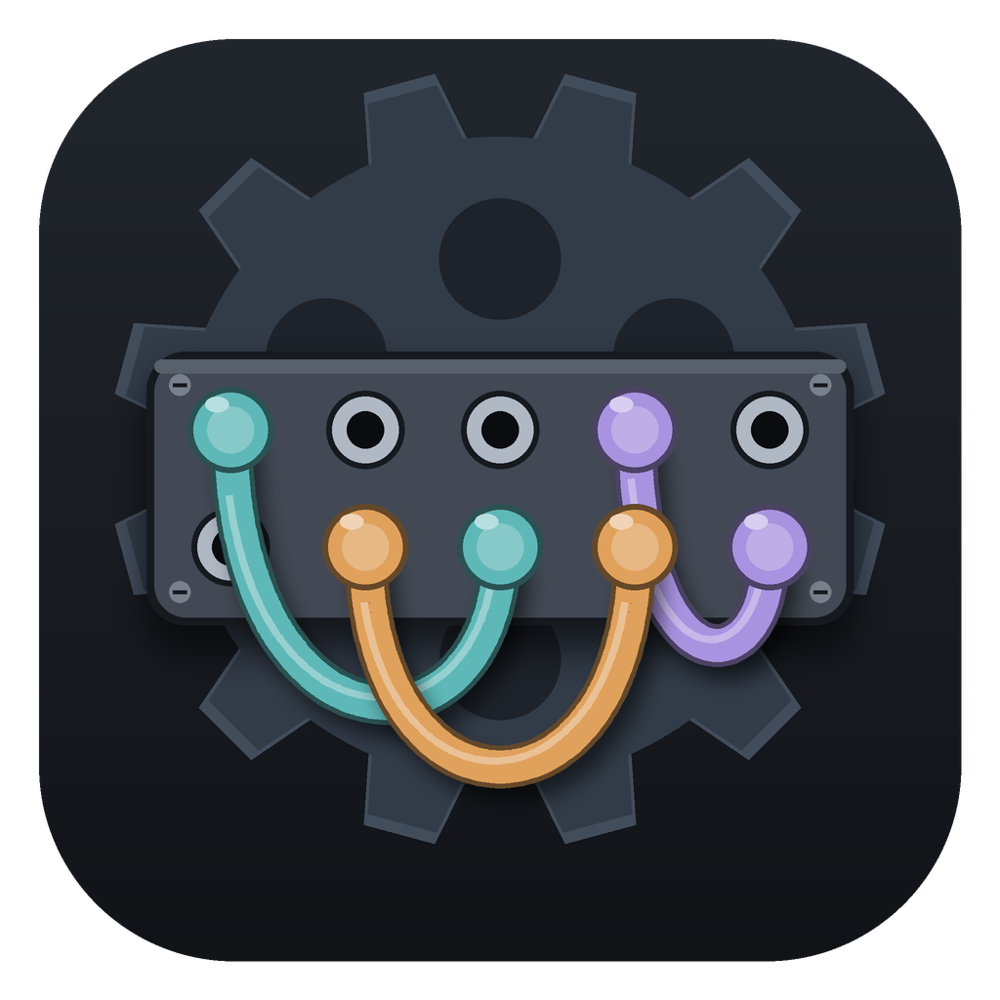

<p align="center"></p>

# sensor-patchbay

Turn any sensor into any output, by patching cables.

sensor-patchbay works like a studio patchbay for input devices. **Sources** (things
that sense) appear as jacks on the left, **sinks** (things that act) as jacks on
the right, and you connect them with **cables**. Each cable can reshape its signal
on the way through: scale it, smooth it, add a deadzone, turn a level into an
on/off switch, or let a second signal decide when it passes. Everything changes
live, with no restarts, and a whole setup saves as a **preset** you can reload or
share.

**[Download the desktop app](https://github.com/JustinParkGithub/sensor-patchbay/releases/latest)**
for Windows, macOS or Linux.

---

## Getting started

1. **Install the app.** Download the file for your system from
   [Releases](https://github.com/JustinParkGithub/sensor-patchbay/releases/latest)
   and unpack it.

   | system | open |
   |---|---|
   | Windows | `SensorPatchbay.exe`. The app is unsigned, so SmartScreen asks once: *More info → Run anyway* |
   | macOS | Move `Sensor Patchbay.app` to Applications. The first time, right-click it and choose **Open** |
   | Linux | `SensorPatchbay`. Needs WebKitGTK 4.1; the tray icon needs AppIndicator on GNOME |

2. **Get some modules.** The app starts empty. Click **Browse…** to install the
   sources and sinks for your hardware, or install a **preset**, which brings the
   modules it needs along with it.
3. **Add them.** Pick a source and a sink from the *add* menus at the bottom of
   each column. Their jacks appear, each with a live meter.
4. **Patch.** Click a source jack, then a sink jack. A cable appears and the
   signal starts flowing.
5. **Shape it.** Click the cable to open its chain and add nodes (see below).
6. **Save.** Save the patch as a preset to bring it back later.

Closing the window keeps the patchbay running in the tray (the menu bar on
macOS). Use the tray menu to reopen it or to quit.

Some modules need a permission or setup step the app can't do for you, such as
allowing input control on macOS or pairing a Bluetooth device. Each module's
page in the [module catalog](https://github.com/JustinParkGithub/sensor-patchbay-modules)
explains what it needs.

---

## The patch panel

- **Meters**: every jack shows its live value, so you can see what a sensor is
  doing before you wire it anywhere.
- **Cables**: a pulse runs along each cable at the signal's level. Click one to
  edit its chain, disable it, or remove it.
- **Modules**: add as many as you like, remove one with its **✕**, and swap
  hardware without stopping anything.
- **Presets**: load, save, and start new patches from the preset bar. A preset
  that needs something you haven't installed is marked **⚠**, along with what's
  missing.
- **Browse…**: search the catalog, then install, update or remove modules and
  presets.
- **Upload…**: add a module (a `.zip`) or a preset (a `.json`) from a file, or
  drop files onto the window.
- **PANIC**: switches every output off at once and releases anything held down.
  It's always in the top bar, and you can patch a button to it too.

### Shaping a signal

A cable's chain is a list of nodes that the signal passes through in order:

| to… | use |
|---|---|
| make it bigger, smaller, offset or reversed | `scale`, `offset`, `invert`, `abs`, `clamp`, `quantize` |
| ignore small movements | `deadzone` |
| get fine control near the centre | `expo` |
| steady a jittery signal | `ema`, `one_euro` |
| limit how fast it can change | `rate_limit` |
| turn a level into on/off | `threshold`, `schmitt` |
| tidy a button | `debounce`, `hold`, `toggle` |
| mix in a second signal | `combine` |
| two-button combos | `chord` (or the **Combos** button) |

**`combine`** brings a second source into a cable. With it, one signal can gate
another (pass only while a button is held, or only while it isn't), or the two
can be added, multiplied, compared, or joined with *and* / *or*. Pairing a *gate*
and an *unless* on the same modifier gives one button two jobs, like a layer on a
macropad.

**`chord`** makes a two-button combo. Each button does its own thing when pressed
alone, and pressing both together does something else *instead*. Open **Combos**
in the top bar, pick the two buttons and up to three outputs (A alone, B alone,
A + B), and it patches the cables for you. Presses that land within the *window*
(60 ms by default) count as together. A solo action starts after the window has
passed, so keep the window short.

Signals are either **continuous** (an axis, a level) or **events** (on/off, a
press). Put a `threshold` or `schmitt` between a continuous signal and an event
jack, so the output doesn't flicker.

---

## Modules and presets

Sources, sinks and presets come from the
[module catalog](https://github.com/JustinParkGithub/sensor-patchbay-modules).
Install them from **Browse…**, and the app sets up whatever each one needs. When
the catalog has a newer version, **Update** appears. If you've changed something
yourself, the app asks before overwriting it.

Everything you install or save lives in your own data folder, so updating the
app keeps it:

| system | data folder |
|---|---|
| Windows | `%APPDATA%\sensor-patchbay\` |
| macOS | `~/Library/Application Support/sensor-patchbay/` |
| Linux | `~/.local/share/sensor-patchbay/` |

**Open data folder** in the tray menu takes you there. Presets are plain JSON
files, easy to copy, share and edit by hand.

---

## Without a screen

The same patchbay can run headless, on a small board or over SSH, with a
text console instead of the panel:

```bash
patchbay --no-ui --cli        # console only
patchbay --cli                # console and the patch panel together
```

Type `help` at the `patchbay>` prompt. The console and the panel edit the same
running patch, so a change in one shows up in the other. The `patchbay` command
ships inside the app folder (on macOS, in
`Sensor Patchbay.app/Contents/MacOS/`), and `patchbay --help` lists every option.

---

## Running from source

```bash
python3.12 -m venv .venv && .venv/bin/pip install uv
source .venv/bin/activate
python run.py            # then open http://127.0.0.1:8420
python app.py            # or as the desktop app (pip install -r packaging/requirements.txt)
```

To build the desktop app yourself, run `pyinstaller packaging/sensor-patchbay.spec`
on each system you're building for. Pushing a `v*` tag builds all three and
publishes them as a release.

## Making your own module

A source or sink is one folder: a short Python file and a manifest of what it
needs. The [module catalog's guide](https://github.com/JustinParkGithub/sensor-patchbay-modules#writing-a-source-or-sink)
walks through writing and publishing one.

## Learn more

- [Overview](docs/OVERVIEW.md): how it all fits together, informally.
- [Specification](docs/SPECIFICATION.md): the exact behaviour and formats.
- [ui/README.md](ui/README.md): working on the patch panel itself.
